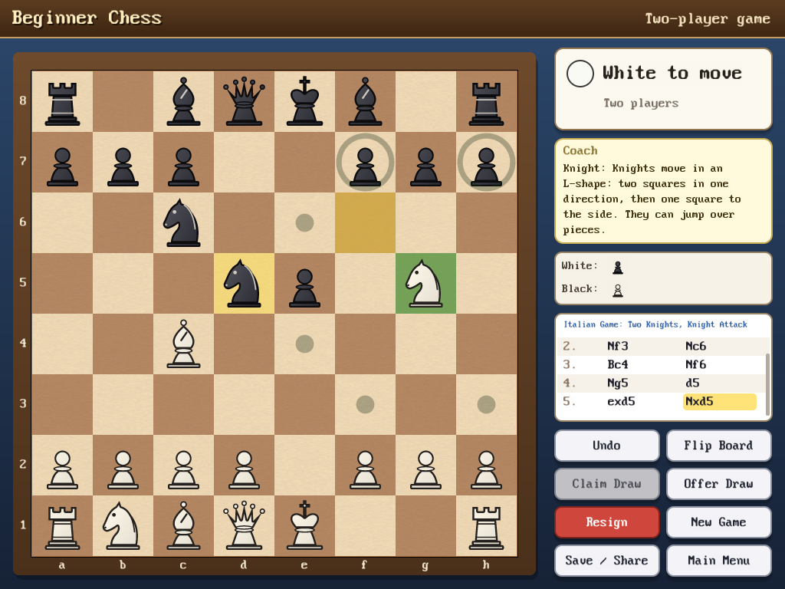
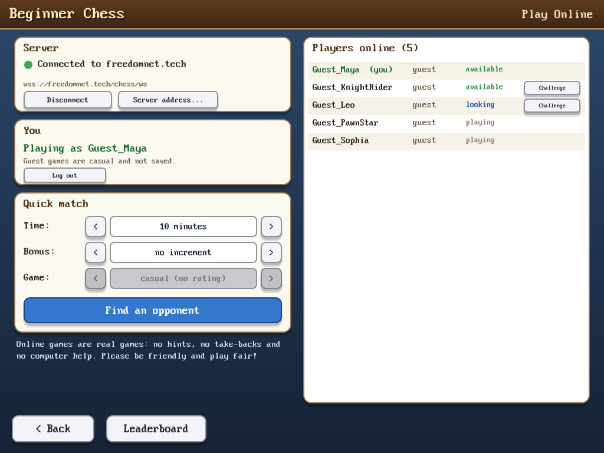
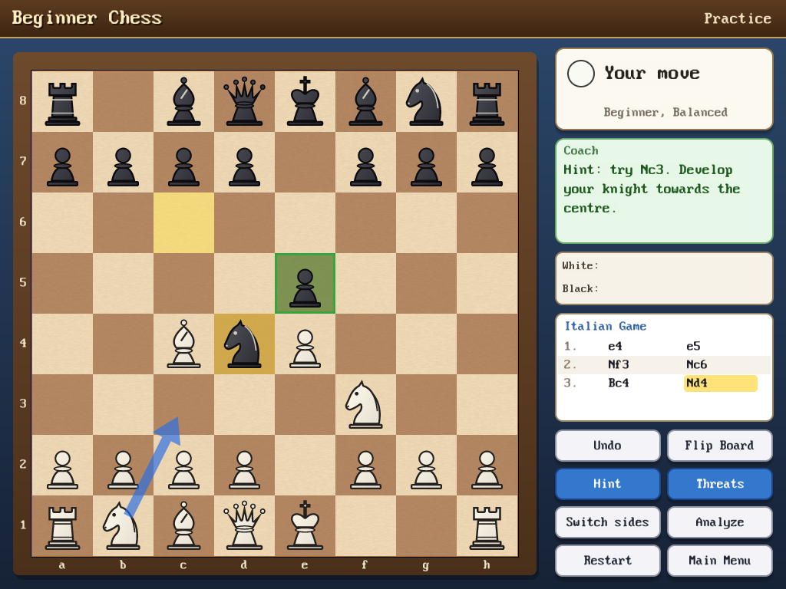
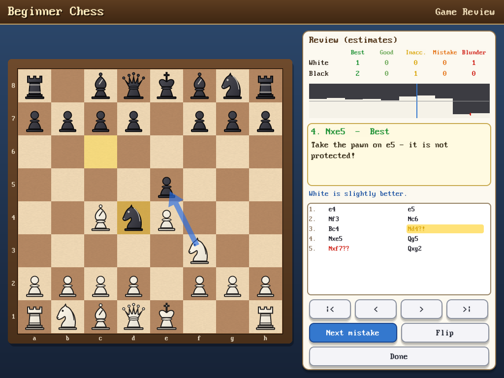

# Beginner Chess

A chess game, computer opponent and chess-learning suite written in
**FreeBASIC**, aimed at children, beginners and intermediate players.
It builds for **Linux 64-bit** and **Windows 32-bit** from the same source.

> **Status: version 2.0.0 - online multiplayer.** New in 2.0: **Play Online** against real
> people over the Internet - free, as a guest or with an account, with quick match,
> challenges, online ratings and a leaderboard (server: `wss://freedomnet.tech/chess/ws`).
> Guide: [docs/ONLINE_GUIDE.md](docs/ONLINE_GUIDE.md). Everything from version 1.0 works as
> before, also without an Internet connection.
>
> Version 1.0 brought complete, tested chess rules, a
> graphical game for two players, a computer opponent with five levels,
> six playing styles and an opening book, saved games with autosave, PGN
> import/export, FEN copy/paste, sound, music, saved settings, the
> **Learn Chess** course (68 lessons), **Chess Puzzles** (70 puzzles) and
> **Famous Games** (an SQLite game library with a move-by-move viewer),
> **Tournament / Career** mode and **Player Profiles** with statistics,
> rating and achievements, **Practice** games with hints and threat
> display, **Game Review** (every move rated and explained) and
> **Analyze Position** with a position editor. A user guide for players,
> parents and teachers is in [docs/USER_GUIDE.md](docs/USER_GUIDE.md).

## Download

Ready-to-run packages are on the
[Releases page](https://github.com/retro778/BeginnerChess/releases):

* **Windows** (32-bit, also runs on 64-bit Windows):
  `BeginnerChess-2.0.0-win32.zip`. Unpack it and start `beginnerchess.exe`.
* **Linux** (64-bit): `BeginnerChess-2.0.0-linux-x86_64.tar.gz`. Unpack it and
  start `./beginnerchess`. You need the X11 libraries; for sound, BASS (see
  *Dependencies*); for online play, libcurl 8.11 or newer.
* **Server** (to run your own multiplayer server):
  `BeginnerChess-Server-2.0.0.tar.gz`. See `docs/SERVER_DEPLOYMENT.md`.

The official online server is `wss://freedomnet.tech/chess/ws` (the default in
*Play Online*).



## What works now

* **Play Online** (new in 2.0) - games against people on the Internet,
  free and without advertising. Play as a **guest** (just a nickname) or
  with an **account** (user name + password, no e-mail). **Quick match**
  (3/5/10/15/30 minutes, 0/2/5/10 seconds bonus, casual or rated), a list
  of **players online** with **challenges**, chess clocks, draw offers and
  claims, resignation, automatic **reconnection** after a network problem
  (the game goes on), **online Elo ratings**, a **profile** with game
  history and replays, and a **leaderboard**. The server checks every move
  and decides clocks, results and ratings; the connection is always
  encrypted (TLS, certificate checked). Online games are real games: no
  hints, take-backs or computer help. See
  [docs/ONLINE_GUIDE.md](docs/ONLINE_GUIDE.md).



* **Practice** - relaxed games against the computer with **Hint** (the
  best move as an arrow, with the reason: "Develop your knight towards
  the centre", "Fork! ..."), **Threats** (your pieces in danger in red,
  enemy pieces you can win in green), unlimited Undo, **Switch sides**
  and **Analyze**. After a real mistake the coach says what goes wrong
  ("Careful! Now your opponent can win your queen with Kxf7. Better was
  Qxe5+.") and the computer waits: press Undo to try again, or Play on.
  Practice games never change your rating.
* **Game Review** - after any game (the "Review this game" button) and
  for every famous game: Beginner Chess studies each move (a progress bar,
  about a quarter of a second per move) and shows counts of best / good
  moves, inaccuracies (?!), mistakes (?) and blunders (??) for both
  sides, an advantage graph (click it to jump), the better move as a
  green arrow with an explanation, what the opponent threatened after a
  mistake, and a "Next mistake" button. Opening-book moves are marked as
  book moves. The ratings are estimates from a quick search, not proofs.
* **Analyze Position** - any position (from the main menu, from a
  practice game, typed/pasted as FEN, or set up with the **position
  editor**: piece palette, eraser, clear, start position, side to move;
  illegal positions are refused with the reason). The computer shows an
  evaluation bar, the evaluation in words, the best move with an
  explanation, the main line and the depth; threats can be shown; moves
  can be tried on the board and taken back; **Play** starts a game from
  the position.



* **Learn Chess** - 68 interactive lessons in 6 chapters: *First steps*
  (the board, notation, every piece, capturing, check, checkmate,
  stalemate, castling, en passant, promotion, draws), *Basic principles*,
  *Tactics* (fork, pin, skewer, discovered attack and check, double
  attack and check, deflection, decoy, removing the defender, overload,
  interference, clearance, in-between move, sacrifice, mating
  combinations), *Strategy* (17 topics from pawn structure to planning, each with a
  task on the board),
  *Endgames* (including "checkmate the computer" practice for K+Q and
  K+R) and *Chess styles in history* (Romantic, Classical, Hypermodern,
  Modern). Lessons show the board with coloured squares and arrows, and
  ask the player to find moves; hints, friendly feedback for typical
  mistakes, and a celebration at the end.
* **Chess Puzzles** - 70 puzzles in 13 categories (mate in one and two,
  win the queen, win material, fork, pin, skewer, defend against mate,
  save the attacked piece, endgame, opening, positional, find the best
  move) with difficulty
  stars, two-step hints, "show solution", explanations, and tracking of
  solved puzzles.
* **Famous Games** - 14 historical games from 1750 to 1997 (Legal's mate,
  the Immortal and Evergreen games, Morphy's Opera Game, Lasker's double
  bishop sacrifice, Steinitz-von Bardeleben, Rubinstein's Immortal, the
  Edward Lasker king hunt, Marshall's "gold coins", Nimzowitsch's
  Immortal Zugzwang, Fischer's Game of the Century, Deep Blue-Kasparov
  1997 and more), each with an introduction and commentary written for
  Beginner Chess. The viewer has First / Previous / Auto Play / Next / Last
  (three speeds, keyboard shortcuts), a clickable move list, board
  flipping and **Play from here** to continue any famous position against
  the computer. Filter by era; add your own PGN files to the library.
* **Tournament** - a *Career* ladder of seven fictional opponents with
  names, ratings, difficulty levels and personalities (Alex 600, Maya
  800, Leo 1000, Sophia 1200, Victor 1400, Nina 1500, the Master 1700):
  beat one to unlock the next. Three *tournaments* (Novice Cup, Club
  Championship, Masters Invitational) are five-player round robins with
  a live standings table; the other players' games are simulated from
  their ratings. Tournament games are rated: no take-backs, no saving
  (leaving a game simply does not count). Every finished career and
  tournament game is added to the player's own PGN file
  (`profiles/<id>/tournament_games.pgn`, with event, round and names).
* **Player Profiles** - several local players (no internet account):
  name, picture, an estimated **player rating** (Elo-style, starting
  at 400, only games without take-backs count; not a FIDE rating) with
  rank titles, games/wins/draws/losses, score %, checkmates, streaks,
  puzzles and lessons, tournaments and career progress, recent games.
  Each player has their own lesson and puzzle progress.
* **20 achievements** (First Victory, First Checkmate, Puzzle Solver,
  Fork Expert, Castling Expert, Ten Games Played, Champion, ...) with
  pop-up messages; can be switched off in Options.
* Lessons and puzzles are plain text files (`data/lessons`,
  `data/puzzles`) that teachers can edit or extend; `tests/test_content`
  checks every position, move and puzzle solution with the rules and the
  engine.

* **Play against the computer** or against a friend on the same
  computer. Choose White, Black or Random.
* **Computer opponent** with five levels — Beginner, Easy, Normal,
  Intermediate, Advanced — and six personalities — Balanced, Defensive,
  Aggressive, Positional, Tactical, Material. The beginner levels make
  natural, human-like mistakes instead of random moves. The computer
  thinks in the background, so the window never freezes. It answers draw
  offers, claims draws when it is not better, and resigns only when it
  cannot win and is about to lose (a forced mate, or hopelessly behind
  for three moves - and never when you could not checkmate anyway).
  Undo takes back your move and its reply.
* **Opening book** (`data/openings/book.txt`, 77 named lines with ECO
  codes, easy to edit): the computer varies its openings; beginners know
  only the first few moves. The name of the opening you are playing is
  shown above the move list (e.g. "Sicilian Defence: Najdorf Variation").
* **Saving**: 8 save slots plus an automatic save after every move -
  "Continue Game" in the main menu brings you straight back. Saves are
  ordinary PGN files (readable by any chess program) with extra
  Beginner Chess tags; damaged files are detected and reported.
* **PGN**: export the current game; import games from PGN files (choose
  the file, then the game, then *Replay* it move by move or *Play on* from
  its last position). Includes three classic games in
  `data/games/classics.pgn`.
* **FEN**: copy the current position to the clipboard (and to
  `saves/position.fen`); start a game from a FEN position typed or pasted
  on the New Game screen.
* Friendly main menu, new-game screen, options and about screen.
* **Mouse control**: click a piece and then its destination, or drag
  and drop. Legal moves are shown as dots, captures as rings; the
  selected piece, the last move and a king in check are highlighted.
* **Coach box** for beginners: explains how the selected piece moves and
  *why* a move is not allowed ("Your bishop is pinned...", "You can't
  castle through check...", "Pawns capture diagonally...").
* Promotion chooser, captured-pieces display with material count,
  scrolling move list, smooth move animation, board flipping.
* **Complete chess rules**: castling with every restriction, en passant,
  promotion and under-promotion, check, checkmate, stalemate,
  insufficient material, resignation, draw by agreement.
* **Tournament (FIDE) draw rules**: threefold repetition and the
  fifty-move rule may be *claimed* by the player to move (also for the
  position their intended move would create — Beginner Chess asks); the
  fivefold repetition and 75-move rules end the game automatically.
* **Sound and music** through the BASS library: a wooden "knock" for
  moves, captures and castling, bells for check, a fanfare for checkmate
  and victory, a gentle tune for a defeat, a "bonk" for illegal moves,
  clicks for buttons, and optional calm background music. Every sound and
  the music are generated by Beginner Chess itself (no third-party audio).
  Your own files in `sound/effects` and `sound/music` can replace them.
  If BASS or a sound card is missing, Beginner Chess simply plays silently.
* **Options** (saved in `beginnerchess.ini`): board theme, piece set
  (Classic or Bold), legal-move dots, coordinates, animation speed,
  beginner help, sound on/off and volume, music on/off and volume, window
  size (only sizes that fit your screen), full screen. The New Game
  screen remembers your last choices.
* Five board themes: Classic, Wood, Marble, Simple, High Contrast; two
  piece sets.
* Original piece set and board textures drawn by the program itself —
  no third-party artwork.
* FEN loading/saving and SAN notation in the core (used by the GUI and
  by the coming PGN/lesson/puzzle features).

## The computer opponent

| Level | How it plays |
|-------|--------------|
| Beginner | Looks one move ahead without checking replies, adds a lot of "noise" and picks among plausible moves — it hangs pieces like a real beginner. |
| Easy | Two moves ahead, sees simple captures; still chooses imperfect moves fairly often. |
| Normal | About four moves ahead (1 s), small randomness. |
| Intermediate | Up to seven moves ahead (2.5 s), always its best move. |
| Advanced | Full strength: searches as deep as it can in 5 s. |

Techniques (`modules/engine.bas`): negamax with alpha-beta pruning and
principal-variation search, iterative deepening, a 16 MB transposition
table, move ordering (hash move, MVV-LVA captures, killer moves, history
heuristic), quiescence search, check extensions, null-move pruning and
late-move reductions. The evaluation is tapered between middlegame and
endgame and considers material, piece placement, development, mobility,
king safety, doubled/isolated/passed pawns (including the "rule of the
square"), centre control, space, rooks on open files and the 7th rank,
the bishop pair, threats to pieces, and how to mate a lone king. Styles
re-weight these terms differently for the computer's own side and for
the opponent (e.g. *Aggressive* values the enemy king's weaknesses more
than its own safety and avoids draws).

It searches roughly a million positions per second on an ordinary PC.
It is a friendly sparring partner, not a professional engine.

## Controls

| Action | Mouse / key |
|--------|-------------|
| Move a piece | click the piece, then the target square — or drag it |
| Cancel a selection | click the piece again, or press **Esc** |
| Take back a move | **Undo** button, **U**, **Backspace** or **←** |
| Flip the board | **Flip Board** button or **F** |
| Leave the game | **Main Menu** button or **Esc** |
| Save, export PGN, copy FEN | **Save / Share** button |
| Type into a text box | keyboard; **Ctrl+V** or the **Paste** button pastes |
| Explanations | hover over any button for a tooltip |

## Directory structure

```text
BeginnerChess/
├── beginnerchess.bas      main program (screen loop, --screenshots mode)
├── build.sh / build.bat   build scripts (Linux / Windows)
├── package.sh / package.bat  release packages (dist/)
├── LICENSE.txt            MIT licence
├── modules/
│   ├── chessdefs.bi       shared constants and types
│   ├── rules.bi/.bas      chess rules, move generation, FEN, draw rules
│   ├── notation.bi/.bas   SAN and coordinate notation
│   ├── game.bi/.bas       game controller: record, result, claims, undo
│   ├── engine.bi/.bas     computer player: search, evaluation, levels, styles
│   ├── openings.bi/.bas   opening book and opening names
│   ├── pgn.bi/.bas        PGN reading and writing
│   ├── savegame.bi/.bas   save slots and autosave (PGN + `CM...` tags)
│   ├── clipboard.bi/.bas  copy/paste (Win32 API / xclip, xsel, wl-clipboard)
│   ├── lessons.bi/.bas    lesson file loader and task checking
│   ├── puzzles.bi/.bas    puzzle file loader and move judging
│   ├── progress.bi/.bas   completed lessons, solved puzzles (progress.ini)
│   ├── db.bi/.bas         SQLite wrapper (library loaded at run time)
│   ├── famous.bi/.bas     Famous Games library (database + PGN fallback)
│   ├── profile.bi/.bas    player profiles, statistics, rating, achievements
│   ├── career.bi/.bas     career ladder, opponents, tournaments
│   ├── coach.bi/.bas      exchange evaluation, threats, move explanations
│   ├── analysis.bi/.bas   whole-game analysis and move classification
│   ├── boardctl.bi/.bas   reusable interactive board (lessons, puzzles)
│   ├── audio.bi/.bas      BASS (loaded at run time), sound synthesiser, music
│   ├── explain.bi/.bas    child-friendly rule explanations
│   ├── gfx.bi/.bas        drawing helpers, smooth scalable text
│   ├── pieces.bi/.bas     original vector piece set
│   ├── board.bi/.bas      board view: themes, highlights, coordinates
│   ├── gui.bi/.bas        buttons, selectors, tooltips, dialogs, input
│   ├── settings.bi/.bas   preferences file, data folder
│   ├── screens.bi         screen declarations
│   ├── menu.bas           main menu, new game, options, about
│   ├── files.bas          save/load and PGN import screens
│   ├── learn.bas          Learn Chess and Chess Puzzles screens
│   ├── famousui.bas       Famous Games list and game viewer
│   ├── profileui.bas      Player Profile screen, achievement pop-ups
│   ├── tournamentui.bas   Tournament hall (career + tournaments)
│   ├── review.bas         Game Review screen
│   ├── analyzeui.bas      Analyze Position screen and position editor
│   ├── play.bas           the game screen
│   ├── json.bi/.bas       strict JSON reader/writer (with size and depth limits)
│   ├── net.bi/.bas        secure WebSocket client: libcurl (Linux) / WinHTTP (Windows), worker thread
│   ├── online.bi/.bas     multiplayer protocol client, online game model, reconnection
│   ├── onlineui.bas       Play Online screens: lobby, online game, profile, leaderboard
│   └── tokenstore.bi/.bas "remember me" login token (DPAPI on Windows, private file on Linux)
├── tests/test_core.bas    rules unit tests and perft
├── tests/test_engine.bas  engine, opening book and resignation tests, benchmark, matches
├── tests/test_pgn.bas     PGN and save-game tests
├── tests/test_audio.bas   sound synthesis, BASS start-up, settings file
├── tests/test_content.bas validation of all lessons and puzzles
├── tests/test_famous.bas  SQLite wrapper and game library (also without SQLite)
├── tests/test_profile.bas profiles, rating, achievements, career, tournaments
├── tests/test_coach.bas   exchange evaluation, threats, explanations, game analysis
├── tests/test_gfx.bas     colour arithmetic (32-/64-bit)
├── tests/test_json.bas    JSON parser/writer, limits
├── tests/test_tokenstore.bas  remembered-login storage
├── tests/test_online.bas  network client against a real server (used by the server tests)
├── tests/online_check.bat Windows: WinHTTP checks against public test servers
├── server/                multiplayer server (Python): see server/README.md
├── data/openings/book.txt opening book (editable text)
├── data/lessons/*.txt     the Learn Chess course (editable text, format in lessons.bi)
├── data/puzzles/*.txt     the puzzles (editable text, format in puzzles.bi)
├── data/games/famous.pgn  source of the Famous Games library (editable PGN)
├── data/games/            PGN files shown by "Import PGN" (classics.pgn, ...)
├── data/beginnerchess.db  SQLite library, created and updated automatically
├── sound/effects, sound/music   optional user sound/music files (see README.txt there)
├── images/                assets (CC0/public domain or original only)
├── saves/                 save slots, autosave, exported PGN, position.fen
├── profiles/<id>/         profile.ini, progress.ini, history.txt per player
└── docs/                  user and online guides, protocol, privacy, security, server
                           deployment and operations, architecture notes, asset licences, screenshots
```

## Formerly "ChessMaster"

Beginner Chess was developed under the name *ChessMaster*. Data of that
version keeps working: `chessmaster.ini` is read when no
`beginnerchess.ini` exists yet (settings are then saved under the new
name), `data/chessmaster.db` is renamed to `data/beginnerchess.db`, the
folders `~/.chessmaster` / `%APPDATA%\ChessMaster` are renamed to the new
ones, and old saved games load unchanged (their extra PGN tags keep the
`CM` prefix).

## Where files are kept

Beginner Chess stores `beginnerchess.ini` and the `saves/` folder next to the
program when that folder is writable (portable use). Otherwise it uses
`~/.beginnerchess` (Linux) or `%APPDATA%\BeginnerChess` (Windows).

## Dependencies

| | Linux 64-bit | Windows 32-bit | Needed? |
|---|---|---|---|
| Compiler | FreeBASIC ≥ 1.10, 64-bit, gcc backend | FreeBASIC ≥ 1.10, 32-bit (`fbc32.exe`) | to build |
| Graphics | X11 libraries (`libX11`, `libXext`, `libXpm`, `libXrandr`, `libXrender`) | built into Windows | yes |
| Threads | FreeBASIC thread-safe runtime (`-mt`) | same | yes |
| BASS 2.4 (sound) | `libbass.so` (x86_64) | `bass.dll` (32-bit, in the Windows release zip) | optional - silent without it |
| SQLite 3 (game library) | `libsqlite3.so.0` (system package) | `sqlite3.dll` (32-bit, in the Windows release zip) | optional - built-in games are read from PGN without it |
| Clipboard | `xclip`, `xsel` or `wl-clipboard` | Win32 API | optional - FEN is shown and saved to a file without it |
| Online play | libcurl ≥ 8.11 (`libcurl.so.4`, package `libcurl4`; uses the system's CA certificates) | WinHTTP (built into Windows 8 and newer) | optional - only *Play Online* needs it |

**Linker options:** none beyond the defaults. BASS, SQLite and libcurl/WinHTTP are *not*
linked: Beginner Chess opens them at run time (`DyLibLoad`) and checks every
function it needs, so the same program runs with or without them, and no
import libraries (`.a` / `.lib`) are required on either system.

## Database

The Famous Games library is an SQLite 3 file, `data/beginnerchess.db` (in
the data folder described below). Beginner Chess creates it on the first
start from `data/games/famous.pgn` and the opening book, and rebuilds the
built-in part whenever that PGN file changes; games added by the player
(*Add PGN file*) are kept. Tables:

| Table | Content |
|---|---|
| `meta` | schema version, checksum of the built-in PGN |
| `famous_games` | white, black, event, site, date, year, result, ECO, opening, introduction, source (builtin/user), number of plies, PGN text |
| `game_moves` | one row per half-move: game id, ply, SAN, comment |
| `openings` | ECO code, name and moves from the opening book |

Player data (profiles, statistics, achievements, lesson/puzzle progress,
tournaments) is deliberately kept in small text files under `profiles/`
instead: readable, easy to back up, and independent of SQLite. If the
database cannot be opened or is damaged, Beginner Chess falls back to the PGN
file and says so on the Famous Games screen.

## Building on Linux 64-bit

Requirements: FreeBASIC ≥ 1.10 (64-bit) with its gcc backend, and the
X11 development libraries that FreeBASIC's graphics library links
against (`libX11`, `libXext`, `libXpm`, `libXrandr`, `libXrender`; on
Debian/Ubuntu: `sudo apt install libx11-dev libxext-dev libxpm-dev
libxrandr-dev libxrender-dev`). `-mt` selects FreeBASIC's thread-safe
runtime (the computer thinks in a separate thread).

**Sound (optional):** Beginner Chess loads `libbass.so` (64-bit Linux build
of BASS 2.4 from www.un4seen.com) at run time - put it next to the
`beginnerchess` program or in a system library folder (e.g.
`/usr/local/lib`). Nothing has to be linked; without it the game is
silent.

**SQLite (optional):** the Famous Games library uses `libsqlite3.so.0`
(standard on most Linux systems; on Debian/Ubuntu package `libsqlite3-0`),
also loaded at run time. Without it the built-in famous games are read
directly from `data/games/famous.pgn`, and adding your own games is
disabled.

```sh
./build.sh          # builds ./beginnerchess and all test programs
./build.sh test     # builds and runs the tests
./beginnerchess
```

Manual compile:

```sh
fbc -w all -gen gcc -O 2 -mt -s gui beginnerchess.bas modules/*.bas -x beginnerchess
```

## Building on Windows 32-bit

Requirements: the 32-bit FreeBASIC compiler (e.g. FreeBASIC 1.10.1 winlibs,
`fbc32.exe`) on `PATH`, or set `FBC` to its full path.

```bat
build.bat
build.bat test
beginnerchess.exe
```

`-s gui` builds a Windows program without a console window. For sound,
put the 32-bit `bass.dll` next to `beginnerchess.exe`; it is loaded at run
time, so the program also starts without it. Put the 32-bit `sqlite3.dll` next
to `beginnerchess.exe` as well, for the Famous Games database. Both are in the
Windows release zip. When building from the git repository, download them
(they are not part of the repository, and BASS has its own licence):
`bass.dll` from the 32-bit BASS 2.4 package at <https://www.un4seen.com/>, and
`sqlite3.dll` from the 32-bit "Precompiled Binaries for Windows" DLL at
<https://www.sqlite.org/download.html>; put both in the project folder
(`package.bat` copies them into the package). Linux `.so` files cannot be used
on Windows and vice versa.

Manual compile (from the project folder; the same command as in `build.bat`):

```bat
fbc32 -w all -gen gcc -O 2 -mt -s gui beginnerchess.bas ^
  modules\rules.bas modules\notation.bas modules\game.bas ^
  modules\engine.bas modules\openings.bas modules\pgn.bas ^
  modules\savegame.bas modules\progress.bas modules\lessons.bas ^
  modules\puzzles.bas modules\db.bas modules\famous.bas ^
  modules\profile.bas modules\career.bas modules\coach.bas ^
  modules\analysis.bas modules\audio.bas modules\clipboard.bas ^
  modules\files.bas modules\gfx.bas modules\pieces.bas modules\board.bas ^
  modules\gui.bas modules\explain.bas modules\settings.bas ^
  modules\menu.bas modules\play.bas modules\boardctl.bas ^
  modules\learn.bas modules\famousui.bas modules\profileui.bas ^
  modules\tournamentui.bas modules\review.bas modules\analyzeui.bas ^
  modules\json.bas modules\net.bas modules\online.bas ^
  modules\onlineui.bas modules\tokenstore.bas ^
  -x beginnerchess.exe
```

To check online play on Windows: `tests\online_check.bat` (needs Internet
access; connects to public WebSocket test servers and to sites with broken
certificates, which must be refused).

## Release packages

```sh
./package.sh        # Linux: build, run all tests, write dist/BeginnerChess-<version>-linux-x86_64.tar.gz
```

```bat
package.bat         rem Windows: build, run the tests, write dist\BeginnerChess-<version>-win32.zip
```

A package contains the program, `data/` (lessons, puzzles, opening book,
games), `sound/` (empty folders for your own sounds), `saves/`, the
README, licence and documentation (including the online guide, privacy and security notes); the Windows package also contains
`bass.dll` and `sqlite3.dll`. The database is created on the first start.
The Linux package does not include BASS (see *Dependencies*).
`package.sh` also writes `dist/BeginnerChess-Server-<version>.tar.gz`: the
multiplayer server with its deployment files and server documentation.

## Testing

```sh
./tests/test_core                       # unit tests + quick perft (~1 s)
./tests/test_core --full                # deeper perft (~2–3 s)
./tests/test_core --perft "<fen>" 5     # count nodes for any position
./tests/test_core --divide "<fen>" 3    # per-move counts (debugging)
./tests/test_engine                     # evaluation symmetry, tactics, mates, legality, threads
./tests/test_engine --bench             # search speed
./tests/test_engine --match             # Normal vs Beginner, Advanced vs Easy
./tests/test_pgn                        # PGN reading/writing, save slots, damaged files
./tests/test_audio                      # sound synthesis, BASS start-up (plays two sounds), settings
./tests/test_audio --write /tmp/sounds  # write every built-in sound as a .wav file
./tests/test_content                    # check all lessons and puzzles (about 1 minute)
./tests/test_content --verbose          # ... and show the engine's view of each puzzle
./tests/test_famous                     # SQLite wrapper and game library
BEGINNERCHESS_SQLITE=/nonexistent ./tests/test_famous --nodb   # library without SQLite
./tests/test_profile                    # profiles, rating, achievements, tournaments
./tests/test_coach                      # coach explanations and game analysis
./tests/test_gfx ; ./tests/test_json ; ./tests/test_tokenstore
./tests/test_online wss://freedomnet.tech/chess/ws   # plays a short game - needs a second player (see server tests)
BEGINNERCHESS_CURL=/nonexistent ./tests/test_online --expect-fail wss://localhost/x   # without libcurl
(cd server && .venv/bin/python -m pytest -q)        # server: rules, protocol, games, accounts, security,
                                                    # and the real client over TLS (see server/README.md)
```

Screenshots of every screen can be produced without a display:

```sh
./beginnerchess --screenshots /tmp/shots     # writes menu.bmp, play_*.bmp, ...
```

Environment variables for testing: `BEGINNERCHESS_NOSOUND=1` disables
sound; `BEGINNERCHESS_BASS=<file>`, `BEGINNERCHESS_SQLITE=<file>` and
`BEGINNERCHESS_CURL=<file>` load a library from a specific file (a missing
file simulates a computer without it); `BEGINNERCHESS_CAFILE=<file>` adds a
test certificate authority for a local TLS test server (certificates are
still always checked).

## Known limitations

* Saved games are shared by all players (statistics and progress are
  per player).

* Full screen depends on the system allowing the video mode; if it is
  refused, Beginner Chess stays in a window.
* Move ratings in Game Review and the practice warnings come from a short
  search (about 0.25 s per position); they are good estimates for
  beginner and club games but can be wrong in deep tactical positions.
* Explanations are heuristic teaching hints ("develops a piece", "wins
  material"), not complete analyses.
* Variations in PGN files are skipped (only the main line is kept).
* On Linux, copy/paste needs `xclip`, `xsel` or `wl-clipboard`; without
  them the FEN is shown on screen and saved to `saves/position.fen`.
* Version 2.0 on Windows: the code is checked here by generating and
  compiling the 32-bit C code, but building, running and online play on
  Windows itself are tested by the owner (no Windows machine is available
  to the developer).
* Online play on Linux needs libcurl 8.11 or newer (older distributions,
  e.g. Ubuntu 24.04, ship an older libcurl: everything except *Play Online*
  works there).
* Online: no chat, no spectators, no tournaments, no friends list, no
  password recovery (no e-mail is stored), no cheat detection (see
  `docs/SECURITY.md`). Network delay is not compensated on the clock.

## Licences

Beginner Chess is released under the **MIT License** (see `LICENSE.txt`).
All pieces, boards and graphics are original and generated by the
program; see `docs/ASSETS.md` for the asset record. BASS (used from
Phase 5) is a separately licensed library by Un4seen Developments, free
for non-commercial use; it is not part of the Beginner Chess MIT licence and
is not needed to run the game. All sounds and music are synthesised by
the program's own code. SQLite is public domain. libcurl (curl licence,
MIT-style) is used from the system on Linux; WinHTTP is part of Windows.
The server (`server/`, also MIT) uses the Python packages `websockets`
(BSD-3-Clause) and `argon2-cffi` (MIT), and runs behind Nginx (BSD-2-Clause)
with a Let's Encrypt certificate. No GPL code is used.
