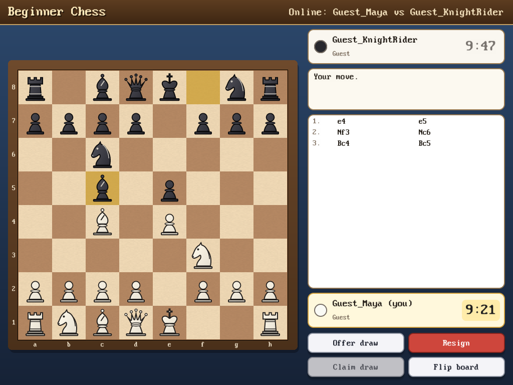
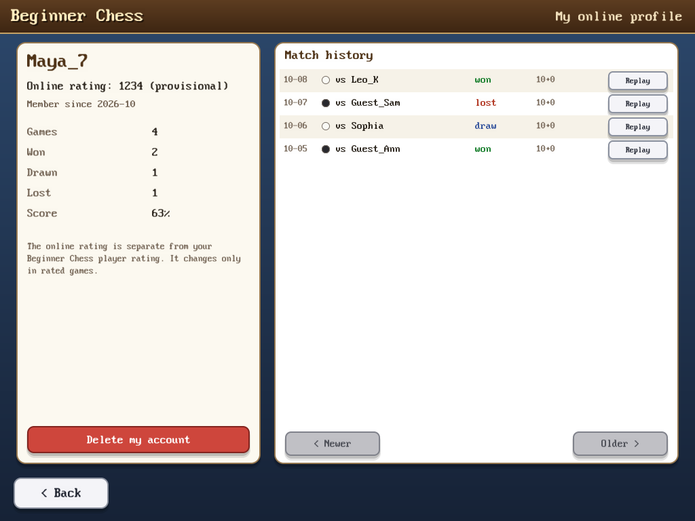

# Beginner Chess Online — guide for players

Since version 2.0, Beginner Chess can play against real people on the
Internet. Online play is **free**: no payment, no advertising, no e-mail
address. Everything else in Beginner Chess (lessons, puzzles, games against
the computer ...) works as before, also without an Internet connection.

## Starting

1. In the main menu choose **Play Online**.
2. Press **Connect**. Beginner Chess connects to the official server
   `wss://freedomnet.tech/chess/ws`. The connection is always encrypted, and
   the server's certificate is checked. If the check fails, Beginner Chess does
   not connect at all.
3. Choose how you want to play:
   * **Play as guest**: no account needed. See [Guest play](#guest-play).
   * **Log in** or **New account**: see [Accounts](#accounts).

When you leave the online area (**< Back**), the connection is closed.
Challenges can only reach you while you are in the online area.

## Guest play

Type a nickname: 3–16 letters, digits or `_`. Other players see it as
`Guest_<nickname>`, for example `Guest_Maya`. Nobody else who is online at
the moment may use the same name.

Guest games are **casual**: they have no rating, and games between two
guests are not saved on the server. (A game against a player with an account
is kept in that player's match history, with your guest name.) Once you leave, the name is free again for anyone.

## Accounts

**New account** asks for:
* a **user name**: 3–16 letters, digits or `_`; it may not start with "Guest";
* a **password**: at least 8 characters, different from the user name. You type
  it twice.

No e-mail address is needed, so **a forgotten password cannot be recovered**.
Please write it down somewhere safe (a child can ask a parent to keep it).

With an account you get a rating, rated games, a game history and a place on
the leaderboard.

**Log in** asks for your user name and password. There are two choices:

* **Log in**: you type the password again next time.
* **Log in and remember me**: next time you only press **Connect**, and the
  login happens by itself for 30 days. Beginner Chess keeps a secret login code,
  never your password. On Windows the code is encrypted for your Windows user;
  on Linux it is a file only you can read, in `~/.beginnerchess`. Do not use
  this on a shared computer.

**Log out** forgets a remembered login on this computer.

**My profile → Delete my account** deletes the account at once after you type
your password: the account, password hash, rating, statistics and logins. The
user name becomes free again. Your finished games stay in your opponents'
histories, but your name in them is replaced by "Deleted player". Games
against guests are deleted with the account.
Details: [PRIVACY.md](PRIVACY.md).

## Finding an opponent

### Quick match
Choose a **Time** (3, 5, 10, 15 or 30 minutes per player) and a **Bonus**
(none, or 2, 5 or 10 seconds added after each move). With an account you can
also choose **Game: rated** or **casual**. Then press **Find an opponent**.
You are paired with the next player who wants exactly the same kind of game.
The colours are chosen at random. **Cancel** stops waiting.

For rated games, the server first looks for an opponent with a similar rating
(at most 200 points apart). The longer you wait, the bigger the allowed
difference becomes.

### Players online and challenges
The list on the right shows who is online:
* **available**: can be challenged;
* **looking**: waiting in quick match;
* **playing**: in a game.

Accounts show their rating, guests show "guest". Click an account's name to
see its profile.

Press **Challenge** next to a player to invite them. The invitation uses the
time and bonus chosen in Quick match. It is rated only if you chose "rated" and
you both have accounts. The other player sees a **Challenge!** window with
**Accept** and **Decline**. A challenge stays open for one minute. Press
**Cancel** to take it back.

## Playing

* Move the pieces as usual (click a piece, then a square, or drag it). The
  move appears on the board and in the move list as soon as the server has
  accepted it. The server checks every move with the full chess rules.
* **Clocks**: your clock runs while it is your turn. The server measures the
  time. The bonus is added after each move. **You have 30 seconds for your
  first move**, otherwise the game is cancelled. If your time runs out, you lose
  the game. It is a draw instead if your opponent could not possibly checkmate
  you (for example a lone king).
* **Cancel game**: before both players have made their first move, either
  player can cancel the game without a result.
* **Offer draw**: your opponent can accept or decline it, or simply make a
  move. **Accept draw** / **Decline** answer an offer.
* **Claim draw**: allowed when the position has been repeated three times, or
  after 50 moves by each side without a capture or pawn move. Fivefold
  repetition, the 75-move rule, stalemate and positions where nobody can
  checkmate end the game as a draw automatically.
* **Resign** gives up the game.
* **Flip board** turns the board around.

There are **no hints, no take-backs and no computer help** in online games.
They are real games against real people. Please be friendly and play fair.

### When the connection breaks
* If **your** connection breaks, Beginner Chess reconnects by itself. It tries
  for up to 90 seconds, after 1, 2, 4, 8 ... seconds, and the game goes on
  where it was. **Your clock keeps running** meanwhile. **Stop trying** gives up
  and leaves.
* If your **opponent** disappears, you see how long they have been away. After
  60 seconds you may press **Claim win** or **Call it a draw**. You can also
  just wait for them.
* If the **server** is restarted, games between two accounts are saved and
  continue afterwards. Games with a guest are cancelled without a result. Nobody
  ever wins or loses because of a server restart.

### After the game
**Review game** opens the move-by-move review from Beginner Chess (best
moves, mistakes, explanations). **Save PGN** saves the game in your saved-games
folder as `Online_<date>_<time>.pgn`. **Back to lobby** returns to the lobby.

## Online rating

* Every account starts at **1200**.
* After a **rated** game, both ratings change with the Elo system. Beating a
  stronger player gains more points, and losing to a weaker one costs more.
* For your first 20 rated games your rating is **provisional**, shown with a
  `?`. In those games it changes faster (K = 40); after that more slowly
  (K = 20). A rating never goes below 100.
* Casual games, guest games and cancelled games never change a rating. A game
  won because the opponent left (Claim win) does count.
* After the game, the new rating is shown in a small message.
* The online rating is separate from your offline **Player rating** in Beginner
  Chess (games against the computer), and each server keeps its own ratings.

**My profile** shows your rating, number of games, wins, draws and losses, and
your game history. **Replay** shows a game move by move. **Leaderboard** lists
the best rated players. Only accounts with at least one rated game are listed.

## Connection troubleshooting

| what you see | what to do |
|---|---|
| "The libcurl library is not installed (package libcurl4)." (Linux) | Install it, e.g. `sudo apt install libcurl4` (Debian/Ubuntu). |
| "The installed libcurl is too old for online play" (Linux) | Online play needs libcurl 8.11 or newer (Debian 13 has it; `curl --version` shows the installed version). |
| "This version of Windows has no WebSocket support" | Online play needs Windows 8 or newer. |
| "The server name could not be found. Is the computer online?" / "The server cannot be reached right now." / "The server did not answer in time." | Check that websites open. Try again later, because the server may be restarting. School or office networks sometimes block it; it uses the normal HTTPS port 443. |
| "The server's security certificate could not be verified." / "A secure connection could not be set up." | Beginner Chess refused the connection because it could not prove that it was talking to the real server. Check the computer's date and time. On public Wi-Fi with a login page, log in there first. Never try to get around this. |
| The server refuses the connection (it is full, or too many new connections came from your address) | Wait a minute and try again. |
| "Too many attempts" / "Too many failed logins" / "Please wait a moment before trying that again." | Wait a few minutes. Logins, registrations, challenges and quick-match joins have limits that protect the server. |
| "Wrong user name or password." | Check Caps Lock. User names are not case-sensitive, passwords are. |
| "Your BeginnerChess version is incompatible with this multiplayer server." | Install the newest Beginner Chess. |
| Moves feel slow | The server's numbers decide. A slow network costs clock time, so prefer longer time controls on weak connections. |

**Server address...** lets you connect to another Beginner Chess server, for
example one run by your school or club. Only `wss://` addresses are accepted,
except `ws://` to your own computer for testing. Accounts and ratings belong to
each server separately. To run your own server, see
[SERVER_DEPLOYMENT.md](SERVER_DEPLOYMENT.md).

## Fair play and safety

* There is no chat, so nobody can send you messages.
* Your profile shows only your name, rating, game counts and games. Nothing
  else about you is stored. See [PRIVACY.md](PRIVACY.md).
* Beginner Chess cannot stop someone from using a chess program on the side,
  and there is no automatic cheat detection. Rated games rely on fair play.
* Server operators can suspend accounts that are abused.
